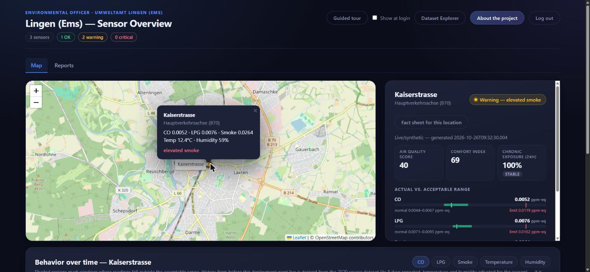
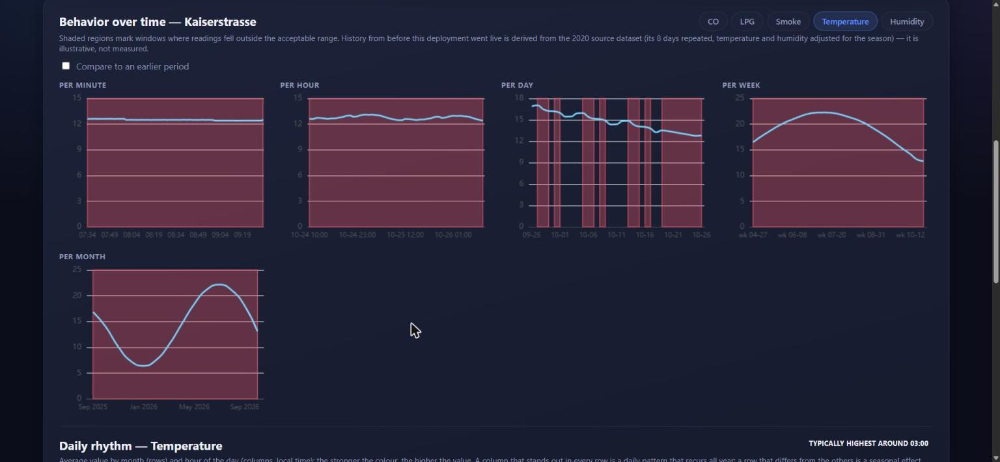
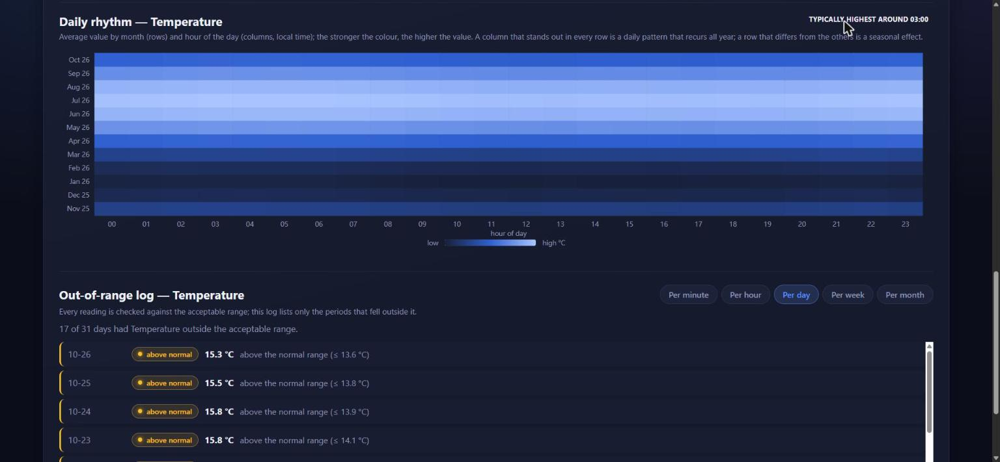
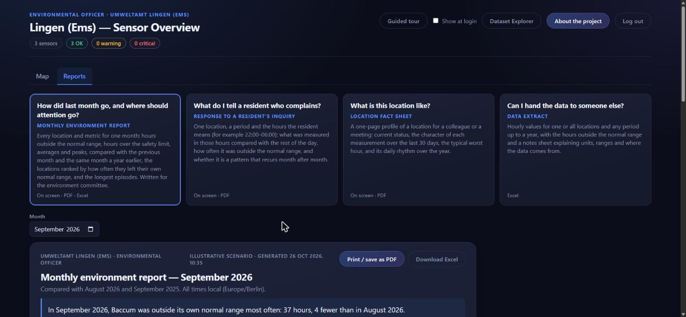
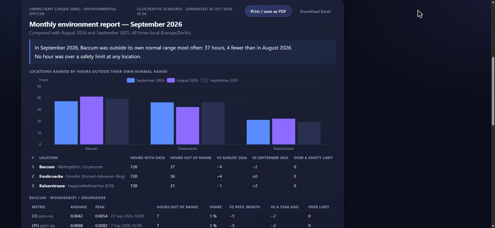
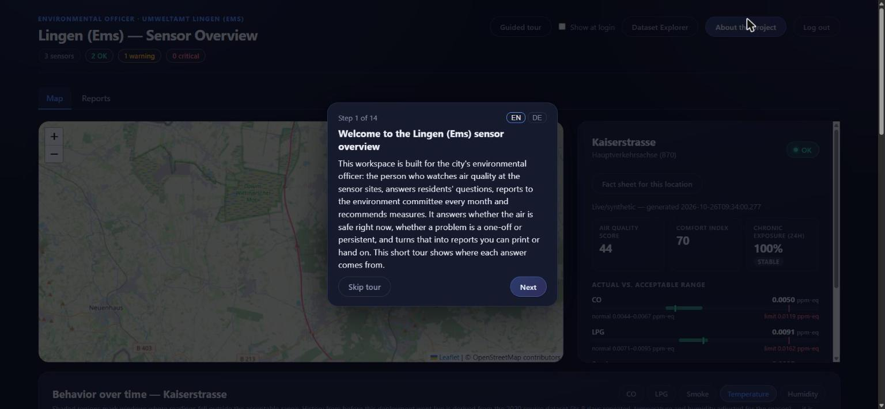
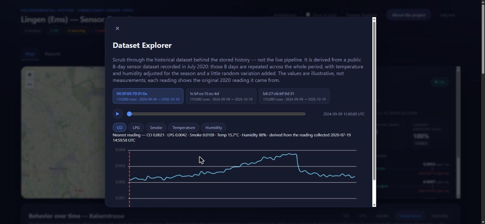
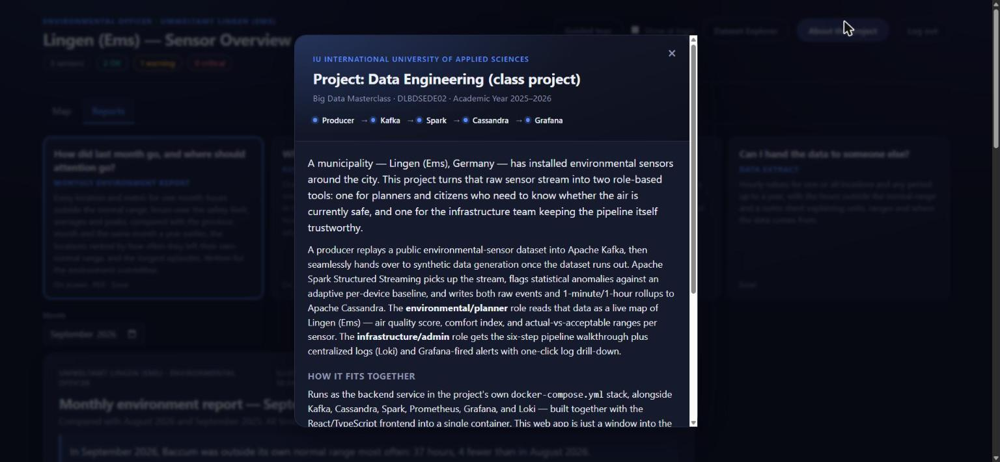

# The live system

**Production URL: <http://169.58.203.205:8000/>** (Grafana runs on port 3000 of the same host).

The screenshots below were taken on **26 October 2026** from the production deployment, logged in
with the planner (environmental officer) account. They show the system as it actually runs, not a
mock-up: every number comes from the streaming pipeline described in the [README](../README.md).

**Where it runs:** one virtual server (11 GB RAM) running native single-node **k3s**. The whole
stack is deployed from this repository's manifests (`k8s/base`) with the `k8s/deploy.sh` script:
Kafka, Spark (master, worker and the streaming job), Cassandra, the producer, the FastAPI/React
backend, Prometheus with its exporters, Grafana, Loki and Promtail. The production runbook is
[`docs/deployment.html`](deployment.html); open it locally in a browser, since GitHub does not
render HTML pages.

**What is not there yet:** no TLS (plain HTTP), no domain name, a single node instead of the planned
three-node cluster, no automated backups. See [`docs/operations.html`](operations.html) → *Status*
for the full list.

**Data honesty:** the source is a public 8-day sensor dataset from July 2020. History before the
system went live is *derived* from it (the 8 days repeated, temperature and humidity adjusted for the
season) and the app labels it as illustrative. Atmospheric pressure is simulated and labeled as such.
Normal ranges are each sensor's own statistical baseline, not legal air-quality limits.

---

## 1. Live map and sensor detail

The environmental officer's start screen. Three sensors are placed in Lingen (Ems) (a main road,
the Ems riverside and a residential area), each colored by its current status. The status bar at the
top counts OK / warning / critical sensors. Selecting a sensor opens the detail panel: an air quality
score, a comfort index, 24-hour chronic exposure, and for each metric the current value against its
normal range and safety limit.

*Pipeline path:* producer → Kafka → Spark (validation, anomaly flags) → Cassandra (`raw_events`,
`device_thresholds`) → FastAPI → React/Leaflet.

## 2. Behavior over time

Five charts per metric (per minute, hour, day, week and month). Shaded regions mark windows outside
the acceptable range. The month chart shows the seasonal temperature curve of the derived history;
the minute and hour charts are live data.

*Pipeline path:* Spark's 1-minute and 1-hour tumbling windows (`agg_1m`, `agg_1h`), plus the
backfilled history (`history-backfill` Job).

## 3. Daily rhythm and out-of-range log

A month × hour-of-day heatmap: a column that stands out in every row is a daily pattern, a row that
differs is a seasonal effect. Below it, the out-of-range log lists only the periods that left the
normal range, at a selectable resolution.

## 4. Reports

Four reports, each answering one question the environmental officer actually has: *How did last
month go?* (monthly report), *What do I tell a resident who complains?* (inquiry response), *What is
this location like?* (fact sheet) and *Can I hand the data to someone else?* (Excel extract). The
first three print to PDF from the browser.

The monthly environment report for the council's environment committee: a plain-language headline,
the locations ranked by hours outside their *own* normal range (so it shows who departed from their
normal, not who is most polluted), compared with the previous month and the same month a year
earlier, then a per-location table.

## 5. Guided tour

A built-in tour (English and German) explains each screen and what it is for. It starts once
automatically and can be replayed from the header.

## 6. Dataset Explorer

Scrub through the historical dataset behind the stored history. Every derived reading shows the
original 2020 reading it came from, so real and derived data are never confused.

## 7. About the project

Course, author and supervisor, and a short description of the pipeline.

---

## Not shown here

- **The infrastructure/admin role** (pipeline health walkthrough, Kubernetes status, centralized
  logs, live Grafana alerts with log drill-down, Cassandra storage and node deploy). It uses a
  separate account.
- **Grafana** (KPI dashboard: throughput and consumer lag, end-to-end latency, anomalies, Cassandra
  health, business aggregates). It has its own login.

Both are described in [`REQUIREMENTS.md`](../REQUIREMENTS.md) (§1, §6, §9) and in the documentation
site under `docs/`.
